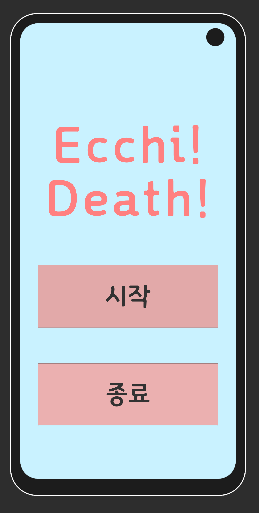
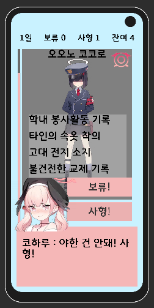
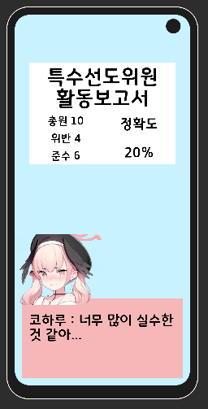
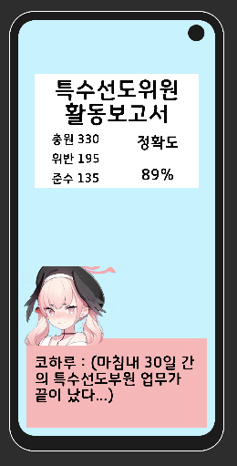

# EcchiDeath

『블루 아카이브』 팬 게임. 정의실현부 코하루가 되어 학생들의 기록을 보고 **보류**할지 **사형**할지 판정하는 모바일 판정 게임 (Unity, 2024).

   

- 하루마다 남은 학생의 기록을 읽고 판정
- 이벤트 · 결과 · 엔딩

> 비공식 팬 제작물이며 NEXON Games · Yostar와 관계가 없습니다. 원작 일러스트가 포함되어 있어 실행 파일은 배포하지 않습니다.
